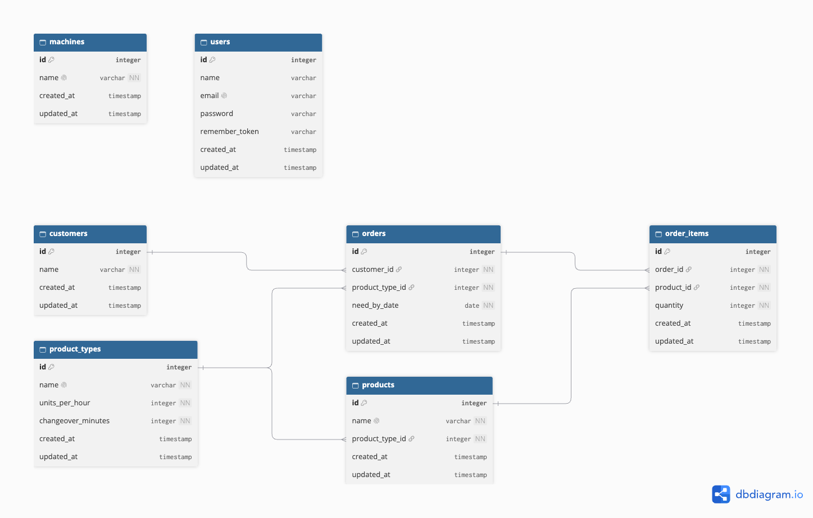

# Decisions and assumptions

How I scoped, modelled and built the production scheduler, and why. Each choice lists the alternatives I left out.

**Context.** A digital printing shop is growing: more products, customers, presses and sites. It needs a tool to plan production so deadlines are met, changeovers cost less, and the short and mid-term load is visible early enough to adjust the organisation. The user is a production manager at ease with software: the app must need no training, give visible feedback on every change, and work desktop first (tablet and mobile second).

## 1. Scope: user stories

Written for the production manager (the planning team), prioritised with MoSCoW.

**Status:** ✅ shipped and tested · 🟡 partly shipped · 📄 not built, choice documented below

### Must

| I want…                                                                                 | so that…                                   | Status                                                   |
| --------------------------------------------------------------------------------------- | ------------------------------------------ | -------------------------------------------------------- |
| to manage customers                                                                     | each order is linked to who ordered it     | ✅                                                       |
| to manage product types with an hourly output and a changeover time                     | production durations can be calculated     | ✅                                                       |
| to manage products and give each one a type                                             | orders can reference them                  | ✅ A product on orders keeps its type.                   |
| to create an order with a customer, a need-by date and several products with quantities | I record what must be produced and by when | ✅                                                       |
| all products of an order to share one type                                              | an order runs without a changeover         | ✅ The type is picked first, then products are filtered. |
| a schedule that prioritises need-by dates and accounts for output and changeovers       | I know what to print next                  | ✅ Greedy algorithm, computed on the fly.                |
| each order's start and end time                                                         | I can commit to delivery dates             | ✅ On the plan and on the orders page.                   |
| orders that will miss their need-by date flagged                                        | I can warn customers early                 | ✅ Banner, timeline badge, status on the orders page.    |

### Should

| I want…                                    | so that…                                     | Status                                                                        |
| ------------------------------------------ | -------------------------------------------- | ----------------------------------------------------------------------------- |
| to manage machines (presses)               | the schedule reflects the shop's capacity    | ✅ The last machine cannot be deleted.                                        |
| the schedule as a timeline per machine     | I spot idle time and changeovers at a glance | ✅ Agenda per machine on mobile.                                              |
| invalid input rejected with clear messages | bad data never reaches the schedule          | ✅ Server-side validation, feature and browser tests.                         |
| an intuitive and accessible plan           | I read the day's plan quickly                | 🟡 Desktop, tablet, mobile and dark mode checked. No accessibility audit yet. |
| the app to open on its sign-in page        | I reach the plan without a marketing page    | ✅ `/` leads to the plan, or to sign-in for guests.                           |

### Could

| I want…                                                 | so that…                      | Status                                       |
| ------------------------------------------------------- | ----------------------------- | -------------------------------------------- |
| same-type orders batched together                       | fewer changeovers are needed  | 🟡 Only on equal need-by dates (v1), see §3. |
| maintenance, breakdowns and holidays taken into account | the schedule stays realistic  | 📄 Machines run 24/7.                        |
| the schedule saved                                      | past plans can be compared    | 📄 The schedule is derived data, not stored. |
| to mark orders as produced                              | finished work leaves the plan | 📄 A delivered order is deleted, see §4.     |

### Won't (out of scope)

Reordering the schedule by hand (it would need a stored schedule), production statistics and exports, integration with the sales portal, roles and permissions.

## 2. Data model

Designed in dbdiagram.io. `users` is Laravel's table, shown simplified: the starter kit adds email verification and two-factor columns.

- **Product type is its own table.** Speed (`units_per_hour`) and changeover time belong to the type, not the product. A new type needs no code change.
- **Customer is its own table**, since one customer has many orders.
- **Quantity lives on `order_items`.** The brief gives none, but a duration needs one. _Assumption:_ each line has a quantity greater than zero. A product appears once per order (unique `(order_id, product_id)`).
- **Need-by date lives on `orders`**: one date per order, as in the brief. Indexed, since the scheduler sorts on it.
- **`orders.product_type_id` is stored on purpose**, although it could be derived from the products. It makes the "one type per order" rule explicit and lets the scheduler read the type directly. Validation protects it: every product must match the order's type, and a product already on orders cannot change type. _Left out:_ validation without the column (nothing to read the rule from), composite foreign keys (strongest, too heavy here).
- **`changeover_minutes` is the time to switch _to_ this type.** It applies only when the previous order on the machine has another type, which is what makes batching worthwhile. The first order on each machine pays it too (setup). All three types start at 30 minutes. _Left out:_ one value in config (what the brief suggests), a from/to matrix (more realistic, more data than the brief needs).
- **Machines are my own initiative, not in the brief.** From my experience in printing, a production plan almost always spans several presses, so I added a `machines` table and the plan assigns each order to a machine. I take full ownership of this choice. Machines are deliberately basic: no attributes, speed depends on the type only. The scheduler was built for one machine, then N. `machines` is linked to nothing, since the schedule is not stored.
- **Deletion:** deleting an order deletes its lines. A customer, type or product still in use cannot be deleted: the app explains why, and a `restrict` foreign key backs it up. Records are hard-deleted; soft deletes were left out, since the brief needs no history.

## 3. Scheduling

**Computed on every view, not stored.** The schedule is derived from the orders and machines. Storing it would add a second source of truth to invalidate on every change, and at this scale the computation is instant. The algorithm is a pure service class ([`Scheduler`](../app/Services/Scheduler.php): orders, machines and a start date in, assignments out), unit tested without a database.

**The order is the unit of scheduling:** one block on one machine, since the type and the need-by date belong to the order and it is delivered complete. _Left out:_ scheduling each line separately (or delivering a late order in batches), which could split an order across machines but adds complexity, and the order would only be done at its last line.

**Algorithm (greedy, v1):**

1. **Duration:** total quantity ÷ speed of the type, in whole minutes, rounded up. Minutes avoid the rounding errors of decimal hours and match `changeover_minutes`.
2. **Next order:** the earliest need-by date. On equal dates, the order that would finish earliest, changeover included: one late order is better than two. This depends on the machines' state, so the next order is picked at each step, not by one sort. Final tie: lowest order id.
3. **Machine:** where the order would finish earliest, so a machine already set up for the type wins. Tie: lowest machine id.
4. **Placement:** start = machine free time + changeover (type change or first order). End = start + duration.
5. **Late:** the order ends after the end of its need-by day, i.e. after midnight the next day. Ending exactly at midnight is on time.

Ties always resolve the same way, so the plan is deterministic and testable.

**Rush orders and changes need nothing special:** the plan is recomputed on every view, so a rush order with an early need-by date moves ahead at once, and an edited or cancelled order reshapes the plan immediately. The limit is that a job already running can move too (see _Freeze started jobs_).

**Start date** is a page parameter (`?start=`, today by default), shared by the plan and the orders page. It is not stored, like the schedule.

**Display:** the plan is the home page after sign-in (no separate dashboard). The timeline uses **vis-timeline**, one row per machine, rather than a hand-made one. _Left out:_ react-calendar-timeline (React API, but its latest version is still in beta).

## 4. Assumptions

- **Machines run 24/7**, with no shifts or downtime.
- **Every order in the database is confirmed and still to be produced**: its proof is approved, and a delivered order is deleted. There is no produced / in progress / upcoming status: the plan is recomputed on every view, so a status derived from the clock would change as soon as an urgent order arrives.
- **Need-by is a date, not a date and time**: the order must be done by the end of that day. With exact times, ties would become rare and the same-type tie-break would almost never apply.
- **The schedule runs in Montreal time** (`America/Toronto`, config `app.schedule_timezone`), whatever the browser's timezone. The app timezone stays UTC for stored timestamps. Durations are real elapsed minutes, also across a daylight saving change.
- **Input bounds**: quantity 1 to 1,000,000, speed 1 to 100,000 units/h, changeover 0 to 1,440 minutes, names up to 255 characters, unique for products, types and machines.
- **A need-by date cannot be in the past** (Montreal time). An existing order whose date has passed can still be edited if the date is kept.

## 5. Stack, auth and deployment

- **Laravel + Inertia (no SSR) + React.** React is the hiring team's stack and what I know best. Inertia avoids a separate API for a single app.
- **PostgreSQL in production, SQLite locally and in tests.** Managed PostgreSQL is simpler to deploy than a SQLite file on a volume. SQLite needs no setup and gives fast in-memory tests. The gap is a small risk: the scheduling runs in PHP, and queries stay on standard Eloquent.
- **Railway**: automatic deploys from `main` once CI passes. Migrations and the idempotent reference-data seeder run before each deploy, the cache warm-up at start.
- **Authentication from the starter kit** (Fortify), kept as-is. One account is seeded from environment variables. No roles. Sign-up stays open: an accepted risk.

## 6. Testing

- **PHPUnit**: unit tests on the scheduler (targeted cases, plus seeded generated plans checked against invariants computed independently), feature tests on every controller and on the validation and deletion rules.
- **Playwright**, local only: sign-in, the order form and its errors, and the plan. No screenshot baselines: they are fragile while the UI still moves.

## 7. Possible improvements

- **Smarter batching (v2):** pull a same-type order ahead to save a changeover when no other order becomes late. Designed and simulated, then left out: it opened several edge cases for a small gain, since one pulled order rarely saves a changeover when the type comes back later.
- **Freeze started jobs:** a job running on a machine must not move when an urgent order arrives. Needs a `schedule_entries` table (machine, order, start, end), and only the rest is rescheduled.
- **Produced status:** a nullable `produced_at` set by a "Mark as produced" action. Produced orders leave the scheduler and appear faded in the orders list, and the actual end can be compared with the estimate.
- **Archiving:** soft deletes on orders, for history and statistics.
- **Need-by time:** a date and time instead of a date, if delivery times matter.
- **Changeover matrix:** a from/to table if some switches take longer than others.
- **Safety margin:** flag an order "at risk" when it ends less than N hours before its deadline, to absorb the unexpected.
- **Machine capabilities and calendar:** per-press setup time and speed, shifts, maintenance and downtime.
- **Proof approval:** orders awaiting proof shown as tentative, outside the committed plan.
- **Live planning preview:** show in the order form where the order would land before saving, through an endpoint that runs the scheduler on the draft.
